

# 🔥 EMBERLINE · Team Planetarium

**26 years of fire activity, on one reference scale.** 
A global burning-activity calendar powered by MODIS–VIIRS harmonization.

NASA Space Apps Challenge 2026 · Seoul · Challenge: *Harmonization of MODIS and VIIRS Hot Spots*

[**▶ Live app**](https://emberline-9sd.pages.dev/en/calendar/) ·
[**Slides (PDF)**](https://github.com/Nasa-Planetarium/nasa-planetarium.github.io/blob/main/Planetarium_%EB%B0%9C%ED%91%9C%EC%9E%90%EB%A3%8C.pdf) ·
[**Models & dataset**](https://github.com/Nasa-Planetarium/Planetarium-AI) ·
[**Data release v1.2**](https://github.com/Nasa-Planetarium/Planetarium-AI/releases)

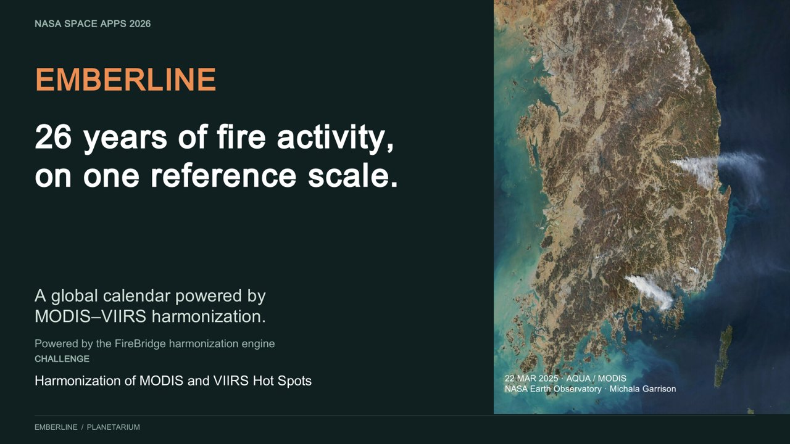

---

## 1. The problem

MODIS (Terra/Aqua, 2000–) and VIIRS (S-NPP, 2012–) both detect active fires, but VIIRS sees many more small fires. If you simply stitch the two records together, burning activity appears to **jump at the 2012 sensor switch**, so a question like *“How unusual was March 2025?”* gets a misleading answer.

In March 2025, South Korea had its worst wildfire season on record (Uiseong, ~99,000 ha affected). For that month, raw MODIS counted **772** detections and raw S-NPP counted **2,764**. Which number should a responder compare against the past?

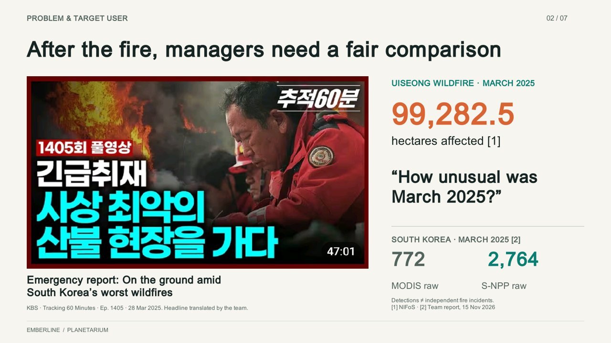

**Who it is for:** wildfire and emergency responders, land managers, and scientists who need a fair comparison of a month against its own history.

> Satellite detections are not independent fire incidents. EMBERLINE reports *burning activity* (fire detections), never a count of fires.

---

## 2. What EMBERLINE does

Pick a region and a month. EMBERLINE shows the month on **one S-NPP-equivalent scale from 2000-11 to today**, tells you whether it is above or below usual, and explains exactly where every number came from.

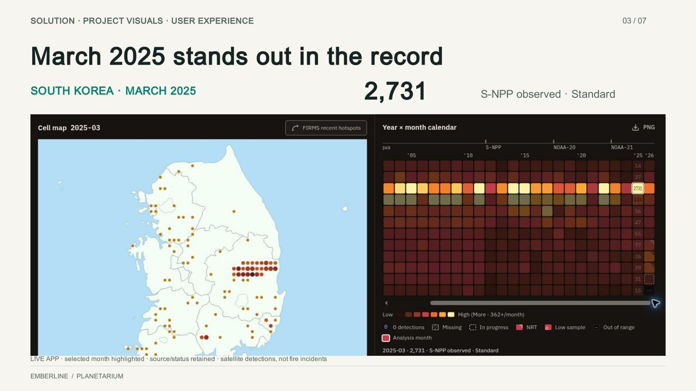

### Calendar — global playback
Monthly burning activity worldwide on a 0.1° grid, replayable from 2001 to the latest month, with a 5° latitude-band × month strip below.

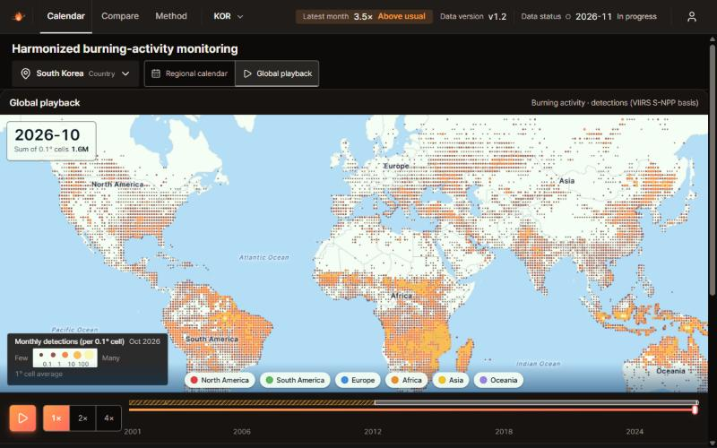

### Calendar — regional view
For any of 5,051 regions (world, continents, 248 countries, 4,524 first-level regions, Korean provinces and districts): a dot map, a **year × month calendar** of the harmonized record, and switches to compare *Harmonized / Before harmonization / Raw MODIS / Raw VIIRS*.

<table>
<tr>
<td>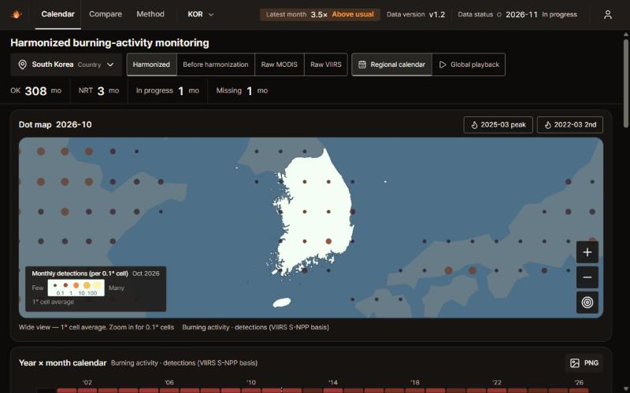</td>
<td>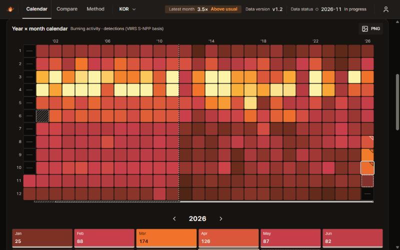</td>
</tr>
</table>

Each month also lists satellite fire events, a fire-type badge, fire intensity (FRP, S-NPP equivalent) and the daily status of every satellite.

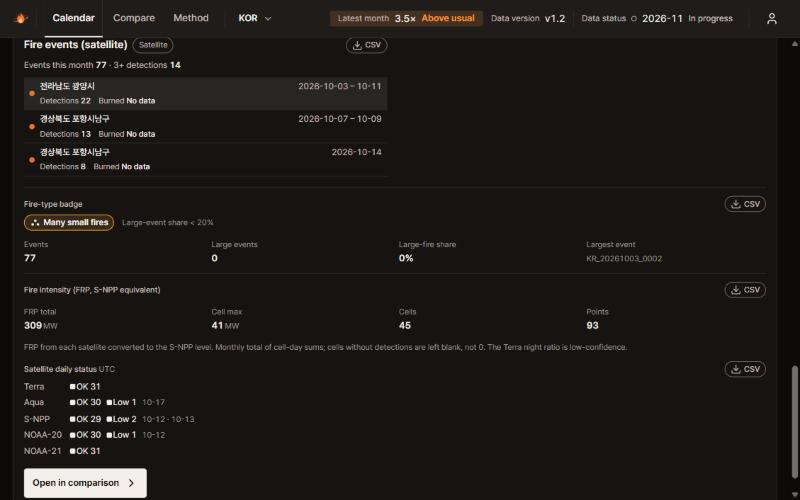

### Compare — scope → calendar → evidence report
A three-step flow: choose the region and month, compare it with the same month in past years, then get a report with method, validation, limitations and sources.

<table>
<tr>
<td>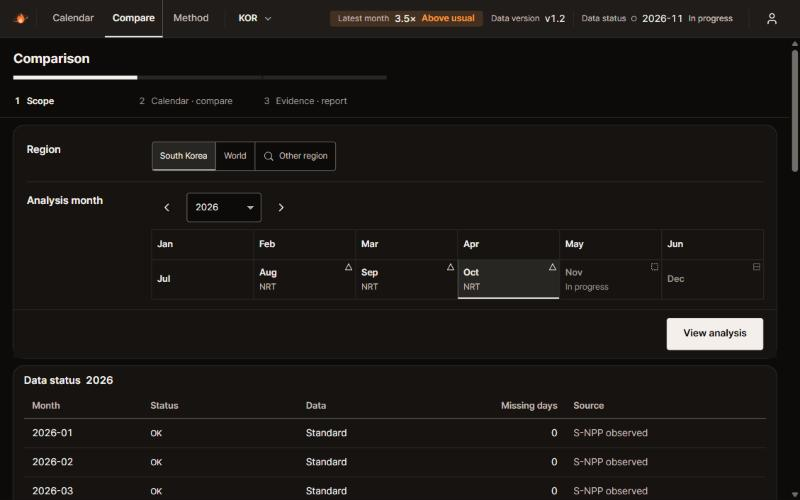</td>
<td>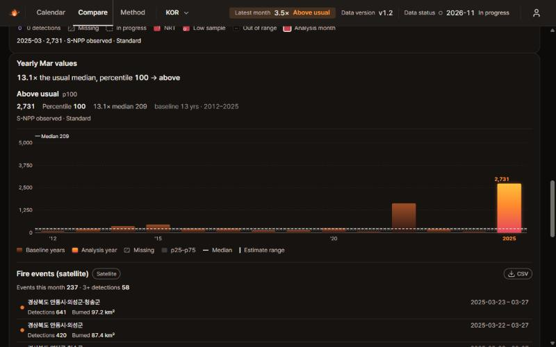</td>
</tr>
<tr>
<td>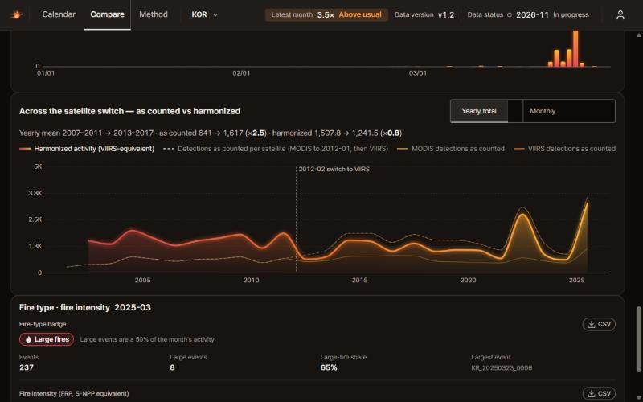</td>
<td>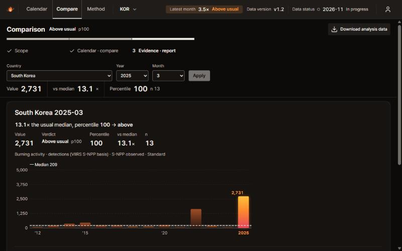</td>
</tr>
</table>

*Example: South Korea, March 2025 — 2,731 (S-NPP observed), **13.1× the usual March median**, percentile 100. The “across the satellite switch” chart shows why: the as-counted record rises ×2.5 at 2012 only because the sensor changed, while the harmonized record does not.*

### Method & Validation — every number is traceable
The app shows which method produced each period, which model version and coefficients were used, and the validation results.

<table>
<tr>
<td>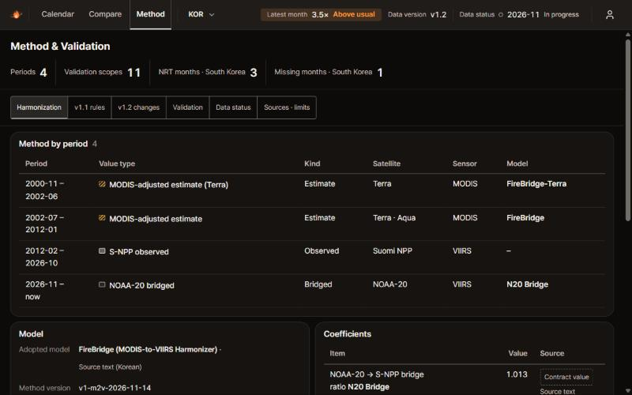</td>
<td>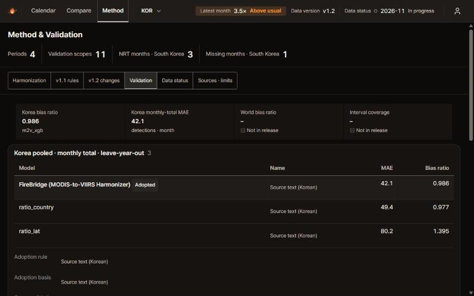</td>
</tr>
</table>

| Period | Value type | Model |
|---|---|---|
| 2000-11 – 2002-06 | MODIS-adjusted estimate (Terra only) | FireBridge-Terra |
| 2002-07 – 2012-01 | MODIS-adjusted estimate (Terra + Aqua) | FireBridge |
| 2012-02 – latest complete month | S-NPP observed | – |
| Current month | NOAA-20 bridged | N20 Bridge |

---

## 3. How it works

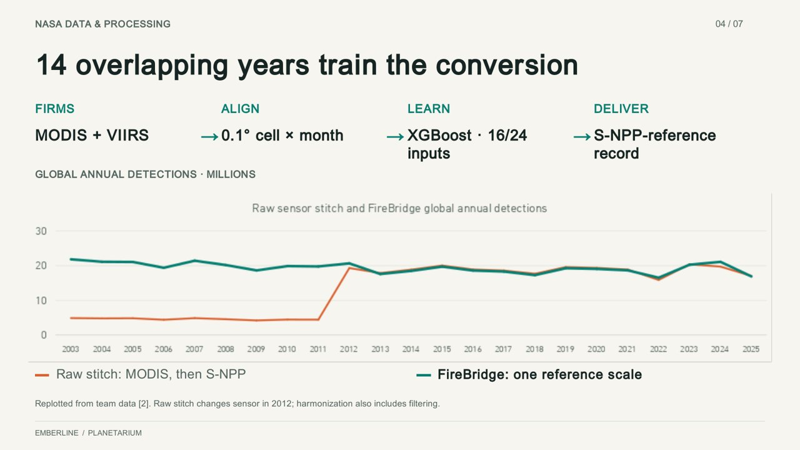

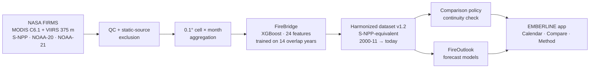

- **Harmonized dataset v1.2** — S-NPP-equivalent burning activity per 0.1° cell-month for 5,051 regions, 2000-11 to the current month, with uncertainty bands, data-status flags (OK / NRT / in progress / missing) and value source on every row. Persistent non-fire heat sources (industry, gas flares, volcanoes) are excluded.
- **FireBridge** — the MODIS-to-VIIRS converter. Gradient-boosted trees (XGBoost, Tweedie loss) learn how many S-NPP detections correspond to a MODIS observation, from the 14 years (2012–2025) when both sensors flew. Variants cover the Terra-only period and bridge NOAA-20/21 to S-NPP for the newest months.

---

## 4. Validation

FireBridge was tested on **years it never saw** (14 leave-year-out tests, 2012–2025) and compared with a simple country × month ratio.

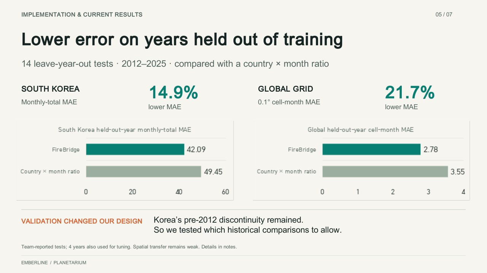

| Test (held-out years) | FireBridge | Baseline |
|---|---|---|
| South Korea, monthly-total MAE | **42.1** | 49.4 (country ratio) · 80.2 (latitude ratio) |
| South Korea, bias ratio (1.0 = unbiased) | **0.986** | 0.977 · 1.395 |
| Global 0.1° cell-month MAE | **21.7 % lower** than the country ratio | — |

<table>
<tr>
<td></td>
<td></td>
</tr>
<tr>
<td></td>
<td></td>
</tr>
</table>

We also report where it is weak: when a whole continent is held out, the model transfers poorly (bias 0.27–0.76×). So EMBERLINE shows an uncertainty band (10th–90th percentile) with every estimate and states this limit in every report.

---

## 5. Validation changed our design

Even after harmonization, South Korea’s pre-2012 record stayed about 30 % high relative to raw MODIS trends. Instead of hiding it, we added a **continuity test** for every region: if the harmonized record does not preserve the raw MODIS trend across the sensor switch (acceptance band 0.85–1.15), the app only compares a month against 2012–2025.

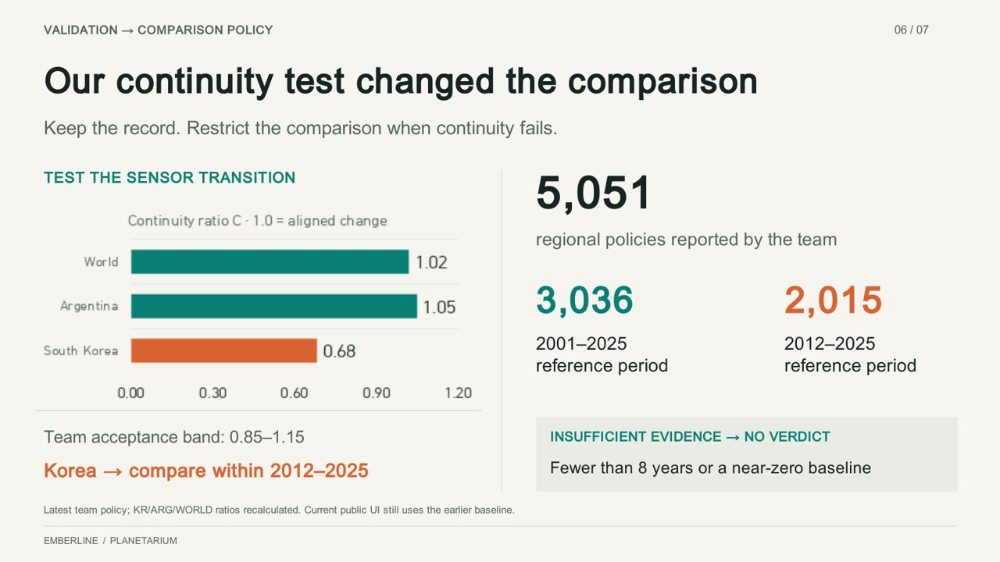

Result: **3,036** regions compare against 2001–2025, **2,015** against 2012–2025, and regions with fewer than 8 baseline years get *no verdict* instead of a guess.

---

## 6. FireOutlook — looking ahead

On top of the harmonized record we built forecast models that give the **probability of burning activity** for any region and any horizon (tomorrow, next 30 days, next months). Every forecast is checked against a seasonal baseline and calibrated, and the API says when the model has no skill so the app falls back to the baseline.

| Model | What it predicts | Method |
|---|---|---|
| FireOutlook Spread | Where detections appear tomorrow near active fires | Gradient-boosted trees, no weather input |
| FireOutlook Monthly (District / Grid) | Chance of burning activity next month | Gradient-boosted classifiers |
| FireOutlook Recurrence | Whether burning activity recurs in a region | Gradient-boosted classifier |
| FireOutlook Planner | Any region, any horizon (day → 12 months) | Direct multi-horizon models + isotonic calibration |

<table>
<tr>
<td></td>
<td></td>
</tr>
</table>

Planner skill over the seasonal baseline (Brier skill score, held-out period): **+15.9 % for tomorrow**, still positive at **+5.4 % two months ahead**.

---

## 7. Impact and next steps

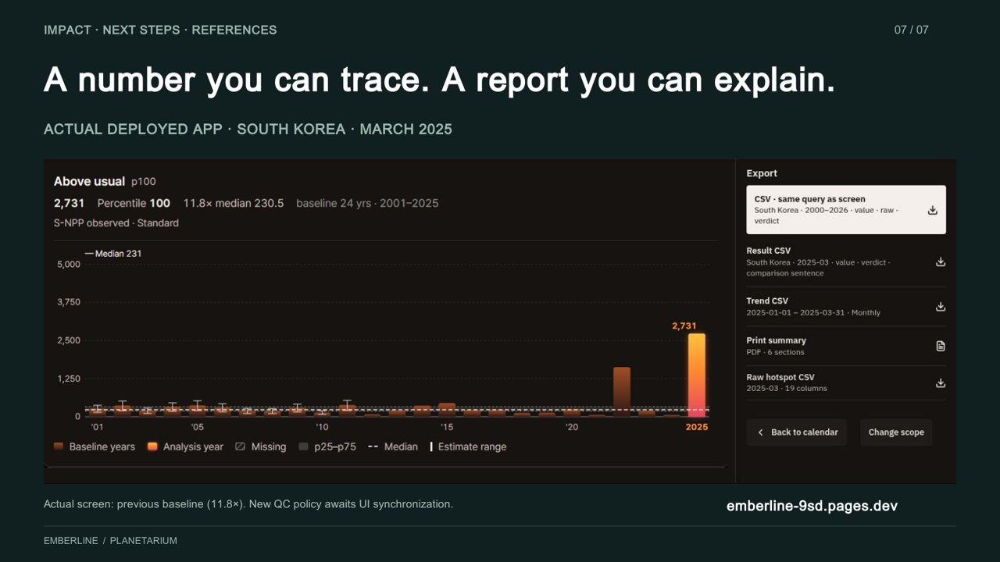

**A number you can trace. A report you can explain.** A responder can open a month, see that it is unusual on a consistent 26-year scale, and hand over a report that states the method, the validation and the limits.

Next: synchronize the new comparison policy in the UI, add burned-area and weather context, and improve spatial transfer for regions with little training data.

---

## Repositories

| Repository | Contents |
|---|---|
| [Planetarium-AI](https://github.com/Nasa-Planetarium/Planetarium-AI) | Harmonized dataset pipeline, FireBridge, FireOutlook, validation reports, data release |
| [Planetarium-Backend](https://github.com/Nasa-Planetarium/Planetarium-Backend) | API server (Java) |
| [Planetarium-Frontend](https://github.com/Nasa-Planetarium/Planetarium-Frontend) | EMBERLINE web app (TypeScript) |
| [nasa-planetarium.github.io](https://github.com/Nasa-Planetarium/nasa-planetarium.github.io) | Project showcase and slides |

## Data

- NASA FIRMS — MODIS Collection 6.1 active fires (Terra, Aqua) and VIIRS 375 m active fires (S-NPP, NOAA-20, NOAA-21), standard and NRT
- Region boundaries and other non-NASA sources are listed in [Planetarium-AI/docs/references.md](https://github.com/Nasa-Planetarium/Planetarium-AI/blob/main/docs/references.md)

Cover image: NASA Earth Observatory (Michala Garrison), Aqua/MODIS, 22 Mar 2025. This project is not endorsed by NASA.

## AI use

AI coding assistants were used to help write code and documentation. All model design decisions, validation and reported numbers were reviewed by the team.
